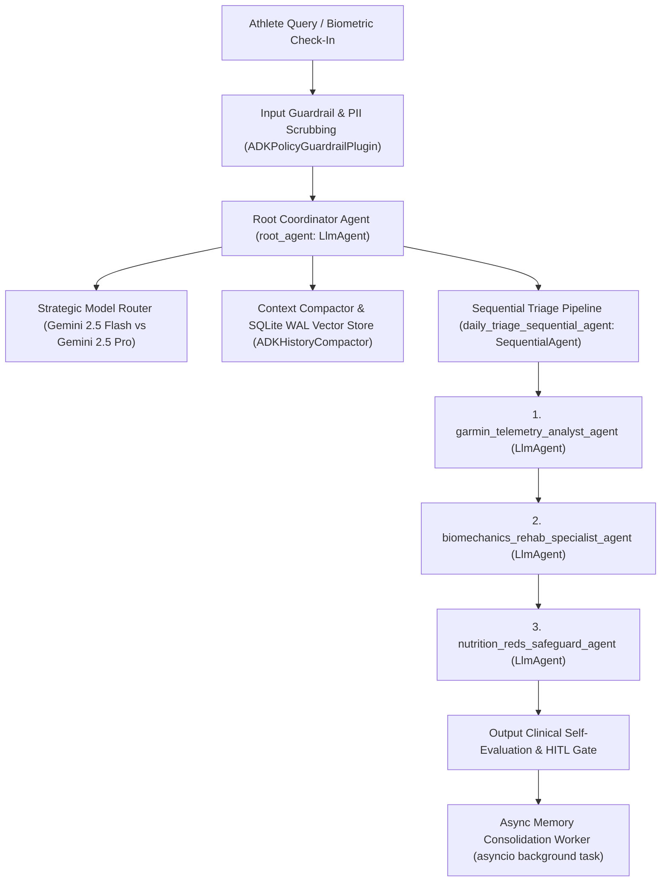

# Endurance Copilot (`adk-python` Multi-Agent Coaching Engine)

**An Autonomous, Closed-Loop Multi-Agent AI Coaching, Google ADK Orchestration & Biomechanical Telemetry Platform**

[-blue?style=flat-square&logo=googlecloud)](agents/agent.py)
[](infra/main.tf)
[](agents/model_router.py)
[](core/observability.py)

---

## Overview

**Endurance Copilot** is a closed-loop physiological and biomechanical coaching system built in **`adk-python` (`google-adk`)**. It ingests wearable telemetry (**Garmin Forerunner 970 + HRM-Pro Plus, Oura Ring Gen 3, and Strava**), evaluates tissue-level running mechanics alongside overnight autonomic recovery, and dynamically adapts:

- **Periodized Macrocycles & Bottleneck Diagnostics:** Anchored on active VDOT (`49.2` from `3:12:58` Rogue Marathon; historical ceiling VDOT `53.5` / `1:28:06` Half Marathon / `58 MPW` peak durability). Automatically inserts a 2-week Reverse Taper when `days_since_last_marathon < 21` and partitions training into Base (`25-35%`), Specific Quality (`45-55%`), and Peak/Taper (`15-20%`).
- **Rolling Jack Daniels 2Q Weekly Microcycles:** Generates 7-day schedules pairing flat road/track quality workouts (`Sunday Q1`, `Wednesday Q2`) with HR/RPE-governed Marin trail easy runs and 2x/week 20-minute Home Gym strength sessions.
- **Closed-Loop Daily Triage (`STAY_THE_COURSE`, `DOWNSHIFT`, `STEP_UP`):** Evaluates the Cardiac vs. Mechanical Differential Matrix and the 3-run directional Ground Contact Time (GCT) asymmetry filter (`> 1.0%` shift).
- **Whole-Food Pescatarian Fueling & RED-S Clinical Gate:** Enforces 100% whole-food pescatarian macros (`>= 150g` protein/day; zero dairy, eggs, shellfish, or refined sugar) and immediately aborts any caloric deficit (`0 kcal` deficit) if Oura HRV drops `> 15%`, soreness `>= 6/10`, or GCT asymmetry is flagged.

---

## Multi-Agent Architecture (`google-adk`)



### Repository Structure

```text
Endurance-Copilot/
├── pyproject.toml                   # Python package & google-adk dependency specification
├── requirements.txt                 # Pinned runtime & evaluation dependencies
├── Dockerfile                       # Production Python 3.11 container image
├── AGENTS.md                        # System ground truth: coaching mandate, biomechanics & nutrition rules
├── README.md                        # Architecture & Google ADK-Python operations guide
├── agent.py                         # Root ADK entrypoint re-exporting `root_agent`
│
├── agents/                          # Google ADK-Python (`google.adk.agents`) Multi-Agent Suite
│   ├── __init__.py                  # Package entrypoint exporting canonical `root_agent`
│   ├── agent.py                     # ADK `LlmAgent`, `SequentialAgent`, `FunctionTool` & `Runner` definitions
│   ├── orchestrator.py              # Coordinator (`EnduranceCopilotCoordinatorAgent`) & Sequential pipeline runtime
│   ├── adk_tools.py                 # 8 schema-validated ADK tools with docstrings & guided error recovery
│   ├── schemas.py                   # Strict Pydantic v2 input/output JSON schemas (`extra="forbid"`)
│   ├── constitution.py              # Formal System Constitution (Persona, Biomechanical Laws, RED-S & 14d Lockout)
│   ├── model_router.py              # Strategic Model Router (`gemini-2.5-flash` vs `gemini-2.5-pro`)
│   ├── guardrails.py                # Input prompt-injection screening, Vertex SafetySettings & clinical self-eval
│   └── hitl.py                      # Human-in-the-Loop confirmation gate (`PENDING_HUMAN_CONFIRMATION`)
│
├── core/                            # Memory Compaction, Observability, PII Redaction & Secret Manager
│   ├── __init__.py
│   ├── memory_compaction.py         # Sliding-window compactor, Vertex Context Cache, Vector Store & Async Worker
│   ├── observability.py             # Structured JSON logging, Intent-vs-Outcome capture & OpenTelemetry spans
│   ├── pii_redaction.py             # Active PII & token redaction via Google Cloud DLP API + regex scrubbing
│   └── secret_manager.py            # Google Cloud Secret Manager client (`google.cloud.secretmanager`)
│
├── infra/                           # Infrastructure as Code (Terraform & CI/CD)
│   ├── main.tf                      # Terraform provisioning Cloud Run v2, Secret Manager, IAM & Memory Bank bucket
│   ├── variables.tf                 # Terraform input variables (`project_id`, `region`, `container_image`)
│   ├── outputs.tf                   # Terraform outputs (Cloud Run URI, Service Account, Memory Bank bucket)
│   └── ci_cd_pipeline.yml           # Automated CI/CD workflow running Golden Dataset & Secret Hygiene checks
│
└── tests/                           # Automated Golden Dataset & Architecture Evaluation Suite
    ├── golden_dataset.json          # Golden benchmark dataset for static triage & RED-S regression evaluation
    └── test_adk_architecture_suite.py # Automated verification suite covering tools, memory, orchestration & IaC
```

---

## Quickstart & Google Cloud Agent CLI (`adk-python`) Operations

### 1. Install Dependencies
```bash
python3 -m venv .venv
source .venv/bin/activate
pip install --upgrade pip
pip install -r requirements.txt
```

### 2. Run & Evaluate with Google ADK CLI (`adk`)
```bash
# Run interactive ADK CLI session with the canonical `root_agent`
adk run agents

# Launch the local ADK Web Inspector UI with OpenTelemetry span visualization
adk web .

# Execute static Golden Dataset evaluation via ADK CLI & Pytest suite
adk eval agents tests/golden_dataset.json
pytest tests/test_adk_architecture_suite.py -v

# Deploy to Vertex AI Agent Engine / Reasoning Engine
gcloud ai reasoning-engines deploy \
  --project=endurance-copilot-prod \
  --region=us-central1 \
  --display-name="Endurance-Copilot-ADK-Coordinator"
```

### 3. Provision Cloud Infrastructure with Terraform (`infra/`)
All runtime secrets (`GEMINI_API_KEY`, `GARMIN_OAUTH_TOKEN`, `OURA_PERSONAL_ACCESS_TOKEN`, `STRAVA_CLIENT_SECRET`) are managed via **Google Cloud Secret Manager** ([`core/secret_manager.py`](core/secret_manager.py)) and provisioned via Terraform ([`infra/main.tf`](infra/main.tf)):

```bash
cd infra
terraform init
terraform validate
terraform plan -var="project_id=endurance-copilot-prod" -var="region=us-central1"
terraform apply -auto-approve
```
